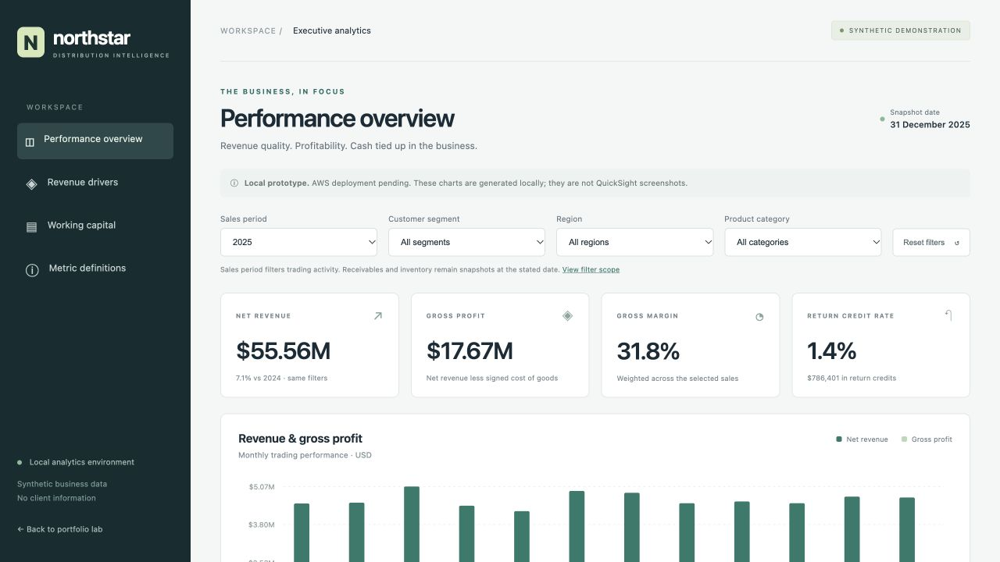
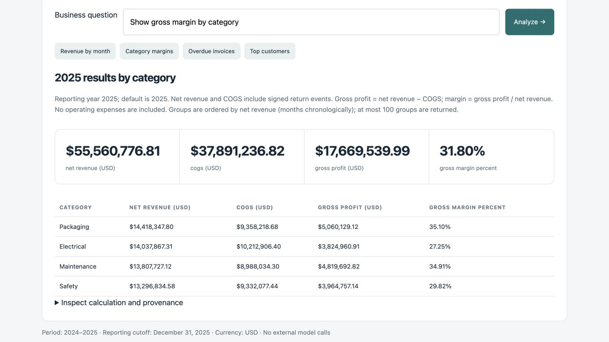
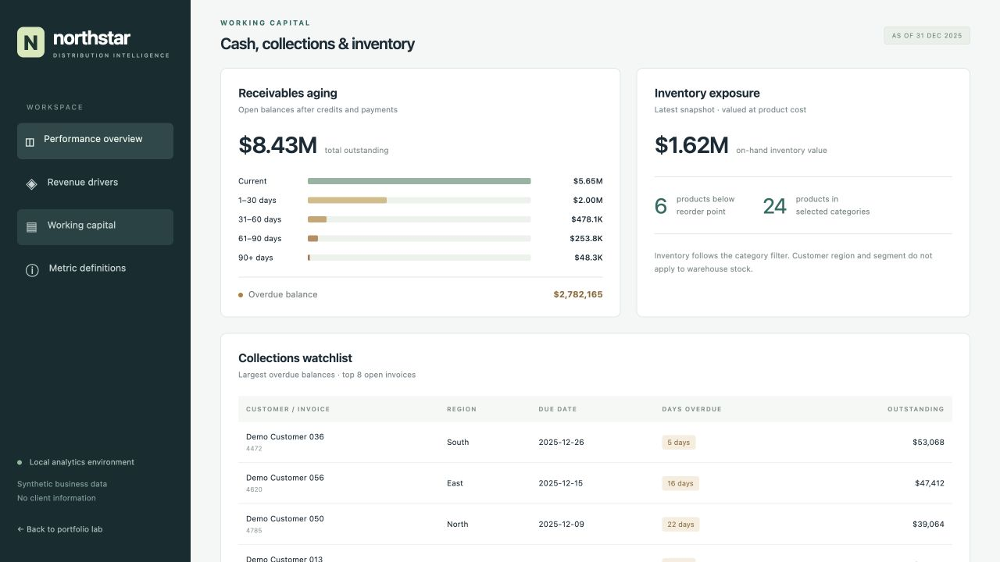

# Distributor Intelligence Lab

Three reproducible portfolio demonstrations for a fictional distributor: a governed analytics assistant, a reliable data pipeline, and a profitability / receivables dashboard.




**All business records are synthetic. This is an independent demonstration, not a client implementation, and none of its results are client outcomes.** The fictional business generates approximately $52–56 million in annual net sales. Its data covers 2024–2025; the reporting cutoff is December 31, 2025.

## Run locally

Requires Python 3.11 or newer. The local core uses the Python standard library; there are no mandatory package installs, API keys, containers, or cloud services.

```sh
python3 -m portfolio_shared.data
python3 verify.py
python3 server.py
```

Open http://127.0.0.1:8765. Stop the server with Ctrl-C. To use another port: `python3 server.py --port 8766`.

## Projects and implementation boundaries

| Project | Local implementation | Optional integrations |
|---|---|---|
| [Analytics assistant](projects/ai_analytics/README.md) | Governed question routing, read-only queries, grounded calculations, explicit abstention | A live LLM requires a configured provider and separate evaluation; the offline demo is not a live AI integration |
| [Data platform](projects/data_platform/README.md) | Incremental ingestion, deduplication, validation, atomic publication, run metadata and recovery | Airbyte, Airflow, dbt and Redshift must be separately installed / executed before claiming those integrations are verified |
| [Analytics dashboard](projects/analytics_dashboard/README.md) | Interactive synthetic profitability and working-capital reporting | Actual Athena / QuickSight deployment requires AWS sandbox access and an approved budget |

## Verify

`python3 verify.py` runs shared-data, component, and integration checks and writes a timestamped result to `artifacts/verification.json`. Failed checks return a nonzero exit code. See each project README for its focused checks. Test outcomes describe this checkout and local environment, not production readiness.

The initial local release passed **47 Python tests plus JavaScript filter/calculation checks**. [Saved report](docs/evidence/local-verification.json) · [Test output](docs/evidence/local-tests.txt). This evidence is a snapshot; the Actions badge above reflects subsequent CI runs.

Generated databases, CSV bundles, logs and verification output are kept in ignored `artifacts/`. Generate a portable CSV export with `python3 -m portfolio_shared.data --export-csv artifacts/csv`.

## Business rationale

The scenario connects engineering to decisions a finance or operations leader can recognize: where gross margin is weakening, which customers have overdue balances, and where inventory is tied up. Sources identify these as real distribution challenges; they do not establish that this demo delivers the outcomes reported in their case studies.

- [Microsoft: Rexel Ireland — inventory accuracy and financial reporting](https://www.microsoft.com/en/customers/story/22950-rexel-dynamics-365-finance), March 19, 2025.
- [Microsoft: Visual Comfort — fragmented data and inventory visibility](https://www.microsoft.com/en/customers/story/21012-visual-comfort-and-co-dynamics-365), January 9, 2025.
- [McKinsey: Pricing in distribution](https://www.mckinsey.com/industries/industrials/our-insights/Pricing-in-distribution-a-strategic-growth-engine), July 17, 2026.

## Documentation

- [Data and metric contract](docs/DATA_CONTRACT.md)
- [Delivery gates and scope](docs/DELIVERY.md)
- [Portfolio presentation](docs/PORTFOLIO.md)

## Screenshots from the running local applications





The images show generated demonstration records, not a client system or AWS deployment. The assistant screenshot shows the governed offline calculation path, not a live model response.

No client credentials, private datasets, proprietary implementation details or employer logos are needed. Repository publication and cloud deployment are separate steps; local completion does not imply either has happened.
