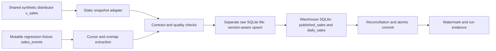

# Reliable data platform: synthetic distributor

An independent portfolio demonstration of data engineering controls for a fictional distributor of roughly $50 million in annual revenue. All records are generated. This is not a client system, a disclosure of client data, or evidence of measured client savings.

## What actually runs

Python standard-library ELT with separate source, raw SQLite and warehouse SQLite files. It publishes validated detail and daily sales marts, tracks a watermark and run metadata, and preserves the last good result after a failed run. No external service, API key, Docker daemon or paid subscription is needed.



Raw merge, mart replacement, watermark and successful run metadata commit in one attached-database SQLite transaction using rollback journals. Failure rolls all these back; the failed attempt is then recorded separately. The source is opened read-only.

## Run from the repository root

```sh
python3 -m projects.data_platform.pipeline
python3 -m projects.data_platform.verify
python3 -m unittest discover -s projects/data_platform/tests -v
```

The default CLI obtains the shared dataset through `portfolio_shared.data.ensure_database()` and writes to `output/data_platform/warehouse.sqlite` plus `warehouse.sqlite.raw.sqlite`. Verification writes its own databases and evidence under this project's `evidence/` folder. Database files are runtime outputs, not source deliverables.

## Data contract and semantics

This project consumes the shared versioned `v_sales` data contract. Grain: one posted sale-line or return event; identifier `event_id` is unique. Returns carry negative revenue, COGS and units. Monetary fields are integer USD cents. `event_date` is the sale/return posting date. Margin is revenue less COGS, not operating profit. A daily total includes returns posted on that day, even when the original sale occurred earlier.

Required fields: `event_id`, `event_date`, `order_id`, `customer_id`, `product_id`, `net_revenue_cents`, `cogs_cents`, `units`, `kind`, `customer_name`, `segment`, `region`, `product_name`, `category`. Integer source dimension IDs are normalized to text in raw/warehouse tables. The pipeline checks required nonempty values, canonical dates, integer money/units, signed sale/return semantics and unique event IDs. Source dimension referential integrity belongs to the shared generator and its tests; this denormalized consumer does not claim to check foreign keys against absent dimension tables.

### Two intentionally different input modes

1. **Shared `v_sales`: static snapshot.** The immutable shared fixture does not expose change timestamps. The adapter reads every row each run and uses the fixture's fixed `2025-12-31T23:59:59Z` watermark. It is not incremental extraction or CDC. Reruns are idempotent. Use `--full-refresh` after replacing the fixture if records have been removed.
2. **Mutable `sales_events`: incremental behavior.** Same fields plus canonical UTC `updated_at` (`YYYY-MM-DDTHH:MM:SSZ`) and integer `is_deleted` (0/1). Extraction uses the last high-water mark minus a default 24-hour overlap. Changes within that overlap are upserted by event ID, and older source versions cannot overwrite newer raw versions. Tombstones remain in raw but disappear from published marts. Tests use this small independent mutable fixture to inject changes and failures against the same transformation contract.

The producer must maintain trustworthy `updated_at` values. The pipeline rejects an entire batch if any timestamp is more than 300 seconds ahead of the run's recorded start time; this explicit clock-skew allowance prevents a bad future timestamp from advancing the cursor. Equal timestamps allow replacement, so a source record must not change without updating its timestamp. Hard deletes are not inferred. Changes older than the overlap are recovered with a full refresh or require a future CDC implementation. This design does not claim unlimited late-update capture.

## Verification evidence

`evidence/unit-tests.txt` is actual unittest output; `evidence/verification.json` records test count, fixture SHA-256, source/detail/daily reconciliation, annual totals and one observed local full-refresh duration. Re-run verification to refresh evidence. The test suite covers initial load, repeated loads, late events, updates, stale versions, soft deletes, signed returns, duplicate/invalid source rejection, rollback after raw merge, rollback before commit and successful retries.

This is a local correctness demonstration. It is not a distributed warehouse, a benchmark against Redshift, an SLA, or a claim of production scale. Review [the runbook](RUNBOOK.md) and [case study copy](CASE_STUDY.md).

## Optional integrations, not executed

The original service positioning mentions Airbyte, Airflow, dbt, Redshift and Superset. This build does not claim those tools ran. The optional dbt SQL under `templates/dbt/` is a starting point for a PostgreSQL/Redshift deployment and must be compiled and tested with the actual chosen adapter. It is not required for, or used by, the verified SQLite pipeline. Airbyte connector configuration, Airflow scheduling, Superset deployment and a real Redshift environment are future opt-in integrations requiring compatible versions and their own acceptance checks. No client credentials or cloud resources are needed for this local build.
